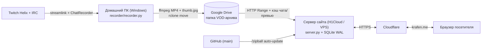

<div align="center">

# KRAFEN.ME

**Личный сайт, живые коллекции и облачный кинотеатр записей стримов**  
На едином автономном сервере **Python FastAPI + SQLite (WAL)** без внешних облачных воркеров


[**Страницы**](#-страницы-сайта) · [**Архитектура**](#-архитектура) · [**Быстрый старт**](#-быстрый-старт) · [**Автозапись и автозапуск Windows**](#-автозапись-стримов-и-тихий-автозапуск-windows) · [**Деплой H1Cloud / Linux**](#-развёртывание-на-хостинге) · [**Переменные `.env`**](#️-переменные-окружения-env)

</div>

---

## ✦ Ключевые возможности

- **Атмосферный интерфейс `danonsha` (60–360 Гц)** — единая обсидианово-багряная эстетика на всех страницах без тяжёлых CSS-фреймворков: процедурный холст дождя, туман, вспышки молний, кастомный тёмный скроллбар, dt-независимая инерционная прокрутка, плавные переходы `View Transitions`, мгновенный prefetch внутренних страниц и нижний док (`Наверх` · `♥` · `Атмосфера`).
- **Живые интеграции на главной** — статус и текущий трек **Spotify** со шкалой прогресса (с автоматическим откатом на **Last.fm**), статус эфира **Twitch Helix**, онлайн **Discord**-сообщества и московское время.
- **Коллекции с защитой от конфликтов (`SQLite WAL`)** — списки фильмов/аниме (`TMDB` + `Shikimori`), игр с оценками и рецензиями (`IGDB`), комплектующих ПК и периферии, а также вишлист с автоматическим пересчётом сумм по валютам и оптимистичной блокировкой по `revision`.
- **Оценки, рецензии и теги во всех коллекциях** — `/watchlist` теперь ведёт личные оценки `0–10`, полноценные рецензии до 5000 символов и теги, как и `/gamelist`; вишлист и игровая библиотека получили теги и избранное (`★`). По тегам и избранному фильтруют одним кликом, поиск учитывает текст рецензий и теги, а любую коллекцию можно выгрузить в JSON-файл прямо со страницы.
- **Полноэкранный кинотеатр записей эфиров (`/danonsha`)** — кастомный плеер 16:9 с потоковой перемоткой через `HTTP Range`, прозрачной поддержкой как `MP4 (+faststart)`, так и сырых потоков `MPEG-TS` (`mpegts.min.js`), синхронизированной панелью **`ЧАТ ЗАПИСИ`** с переходом по таймкодам и автоматическим извлечением реальных кадров VOD для обложек.
- **Приватная схема записи стримов** — домашний ПК в тихом фоновом режиме пишет видео (`streamlink`) и IRC-чат (`chat.jsonl`), перепаковывает контейнер через `ffmpeg`, создаёт `thumb.jpg` и выгружает папку эфира в **Google Drive** через `rclone`, после чего удаляет локальную копию. Публичный сайт работает за Cloudflare и забирает записи из облака — **домашний IP остаётся полностью скрытым**.
- **Безопасность и автономность** — изолированное хранение секретов и OAuth-токенов в `data/auth.db` (`0600`), одноразовый криптографический `CSP nonce` на каждый запрос, `HSTS` / `COOP` / `X-Frame-Options: SAMEORIGIN`, проверка `CSRF` (`Origin` + `Sec-Fetch-Site`), защита от перебора пароля с учётом подсетей Cloudflare, потоковые лимиты тела запроса и встроенное автообновление с GitHub (`/zipball`) без `git`.

---

## ◈ Архитектура



---

## ▤ Страницы сайта

| Маршрут | Файл | Назначение |
| :--- | :--- | :--- |
| `/` | `index.html` | Главная: живой плеер Spotify / Last.fm, часы (МСК), карточки Twitch и Discord, соцсети и реквизиты |
| `/watchlist` | `watchlist.html` | Архив аниме, фильмов и сериалов с **оценками, рецензиями, тегами и избранным**, фильтрами и поиском через **TMDB** и **Shikimori** |
| `/gamelist` | `gamelist.html` | Библиотека пройденных и активных игр с оценками `0–10`, отзывами, тегами, избранным и поиском в **IGDB** |
| `/setup` | `setup.html` | Конфигурация системного блока и рабочей периферии с быстрыми ссылками |
| `/wishlist` | `wishlist.html` | Список желаемых покупок с приоритетами, статусами, тегами, избранным и подсчётом бюджета в `RUB` / `USD` / `EUR` |
| `/tasks` | `tasks.html` | Интерактивный калькулятор ежедневных заданий BP (VIP / X2) и таймеры клубных квестов |
| `/danonsha` | `danonsha.html` | Страница **danonsha**: статус канала, архив стримов из Google Drive, кинотеатр VOD и `ЧАТ ЗАПИСИ` |
| `/admin` | `admin.html` | Панель управления: аналитика трафика и VOD, интеграции, кэш, резервные копии, аудит и `server.log` |
| `/danonsha/` | `danonsha/index.html` | **Личный профиль danonsha**: хаб со счётчиками и ссылками на её коллекции |
| `/danonsha/watchlist` · `/gamelist` · `/setup` · `/wishlist` | `danonsha/*.html` | Собственные коллекции danonsha — полный функционал и отдельные данные |

### Расширенная модель коллекций

| Поле | `watchlist` | `gamelist` | `wishlist` | Назначение |
| :--- | :---: | :---: | :---: | :--- |
| `rating` | `0–10` | `0.0–10.0` | — | Личная оценка (в watchlist — целые баллы, `0` = без оценки) |
| `review` | до 5000 симв. | до 5000 симв. | — | Рецензия или заметки, доступна на чтение всем посетителям |
| `tags` | до 12 тегов | до 12 тегов | до 12 тегов | Метки до 28 символов, без дублей; клик по тегу фильтрует коллекцию |
| `favorite` | `★` | `★` | `★` | Избранное: отдельный фильтр и отметка на карточке |

Теги хранятся в `tags_json` (JSON-массив), оценки и избранное — отдельными колонками. Недостающие колонки в существующей базе добавляются автоматически при старте (`ALTER TABLE`), поэтому миграция ручных правок не требует.

Кнопка **Экспорт JSON** (видна в режиме администратора) выгружает текущую коллекцию в файл `krafen-<collection>-<дата>.json` формата:

```json
{
  "format": "krafen.collection.v1",
  "collection": "watchlist",
  "exportedAt": "2026-11-03T09:00:00.000Z",
  "revision": 41,
  "items": [{ "id": "tmdb_movie_388", "rating": 9, "tags": ["криминал"], "favorite": true }]
}
```

Такой файл принимает `POST /api/admin/restore` (поле `collections`), так что коллекцию можно восстановить из резервной копии или перенести на другой сервер.

---

### Профили: krafen и danonsha

На сайте два независимых профиля. У каждого свои `watchlist`, `gamelist`, `setup`
и `wishlist`, свой пароль и своя сессионная cookie — данные не пересекаются.

| | `krafen` (основной) | `danonsha` (личный) |
| :--- | :--- | :--- |
| Страницы | `/watchlist`, `/gamelist`, `/setup`, `/wishlist` | `/danonsha/watchlist`, `/danonsha/gamelist`, `/danonsha/setup`, `/danonsha/wishlist` |
| Панель | `/admin` | `/admin` (тот же, вход по логину) |
| Пароль | `ADMIN_PASSWORD` | `ADMIN_PASSWORD_DANONSHA` |
| Cookie | `kf_admin_session` | `kf_danonsha_session` |
| Оформление | базовый `style.css` | тот же интерфейс + `danonsha/theme.css` (розово-алый акцент) |

**Как включить профиль danonsha:** задайте `ADMIN_PASSWORD_DANONSHA` в `.env`.
Пока пароль не задан, вход в профиль отключён, а страницы открываются только
для чтения — ровно как `ADMIN_PASSWORD` для основного профиля.

**Вход.** Панель управления одна — `/admin`. На ней два поля: **логин**
(`krafen` или `danonsha`) и пароль. Логин определяет профиль, поэтому логиниться
в danonsha нужно именно там. Выбранный профиль запоминается в браузере и
подставляется в следующий раз.

**Как это устроено.** Коллекции хранятся в тех же таблицах с колонкой `owner`,
первичный ключ — `(owner, id)`, поэтому одинаковый `id` может существовать у обоих
профилей. Старая база миграциируется автоматически при запуске: существующие записи
остаются за `krafen`, у `danonsha` создаются пустые коллекции. Страницы сообщают
профиль заголовком `X-Krafen-Profile`; сервер проверяет cookie именно этого профиля,
поэтому сессия одного профиля не даёт доступа к другому.

Гостевой просмотр общий: обе коллекции видны без входа, редактирование требует пароля.

### Тесты

```bash
npm install jsdom
node tests/pages.test.js http://127.0.0.1:8080 <пароль>            # основной профиль
KF_DANONSHA=<пароль> node tests/pages.test.js http://127.0.0.1:8080 <пароль>   # + профиль
```

## 🗂 Структура проекта

```text
krafenz/
├── server.py               # Единый FastAPI-бэкенд, SQLite, API-прокси, VOD-стриминг, автообновление и CLI
├── app.js                  # Общее клиентское ядро: атмосфера, скролл 60–360 Гц, модалки, админ-сессия
├── style.css               # Единая дизайн-система в эстетике danonsha
├── mpegts.min.js           # Локальный MSE-движок для воспроизведения MPEG-TS записей
├── index.html              # Главная страница
├── danonsha.html           # Страница danonsha и полноэкранный VOD-кинотеатр
├── watchlist.html          # Коллекция фильмов, сериалов и аниме
├── gamelist.html           # Коллекция игр и рецензий
├── setup.html              # Конфигурация ПК и девайсов
├── wishlist.html           # Вишлист
├── tasks.html              # Трекер заданий и таймеров
├── admin.html              # Панель управления, телеметрия трафика/VOD, кэш, бэкапы и логи
├── recorder/
│   ├── recorder.py         # Фоновый рекордер Twitch + IRC-чата + ремукс ffmpeg + выгрузка rclone
│   └── requirements.txt    # Зависимости рекордера (streamlink, websocket-client, requests, telethon)
├── data/
│   ├── krafen.db           # Публичная БД коллекций и индекса VOD (SQLite WAL)
│   ├── seed.sql            # Начальный SQL-сид коллекций
│   ├── auth.db             # Изолированное хранилище OAuth-токенов и ключа сессий (в .gitignore)
│   ├── analytics.db        # База статистики посещений, VOD и журнала аудита (в .gitignore)
│   └── server.log          # Лог работы сервера и рекордера с авто-ротацией 10 МБ (в .gitignore)
├── .env.example            # Шаблон переменных окружения
├── krafen.service          # Защищённый systemd-юнит для Linux-сервера
├── SETUP.md                # Инструкция по развёртыванию через systemd + Caddy / Nginx
└── SPOTIFY_SETUP.md        # Инструкция по привязке Spotify OAuth
```

---

## ⚡ Быстрый старт

### Windows (PowerShell)

```powershell
py -m pip install -r requirements.txt
Copy-Item .env.example .env
# Заполните нужные ключи в .env
py server.py
```

### Linux / macOS

```bash
python3 -m venv .venv
.venv/bin/pip install -r requirements.txt
cp .env.example .env
chmod 600 .env
.venv/bin/python server.py
```

По умолчанию сервер открывается на `http://127.0.0.1:8080` (или на порту, указанном в `PORT`).

---

## 🎥 Автозапись стримов и тихий автозапуск (Windows)

На домашнем ПК `server.py` при `RECORDER=1` автоматически поднимает `recorder/recorder.py`, который следит за каналом Twitch и после завершения стрима выгружает готовую папку эфира на Google Drive:

```text
2026-10-28_23-54_stream-title/
├── video.mp4     # Перепакованный MP4 (+faststart) без потерь качества
├── chat.jsonl    # Лог чата с таймкодами от начала эфира
├── thumb.jpg     # Реальный кадр стрима для обложки на сайте
└── meta.json     # Название, категория, длительность и время старта
```

### 1. Подготовка окружения на ПК

1. Установите зависимости рекордера:
   ```powershell
   py -m pip install -r requirements.txt -r recorder\requirements.txt
   ```
2. Положите `rclone.exe` и `ffmpeg.exe` прямо в корень проекта (или добавьте их в системный `PATH`) и один раз авторизуйте Google Drive через `.\rclone.exe config` (название remote — `gdrive`).
3. Убедитесь, что в `.env` указаны:
   ```dotenv
   RECORDER=1
   RECORDER_CHANNEL=danonsha
   TWITCH_CLIENT_ID=...
   TWITCH_CLIENT_SECRET=...
   GDRIVE_FOLDER_ID=1e417_q9s6SjcZHyqMYzbVs8OHqfY5Ifk
   ```
4. Проверьте подключение к Google Drive одной командой (без ожидания начала эфира):
   ```powershell
   py recorder\recorder.py --test-cloud
   ```

### 2. Управление тихим фоновым режимом в Windows

Все дочерние процессы (`recorder.py`, `streamlink`, `ffmpeg`, `rclone`) запускаются с флагом `CREATE_NO_WINDOW` через `pythonw.exe` — чёрные окна консоли никогда не всплывают поверх игр и полноэкранных приложений.

| Команда | Действие |
| :--- | :--- |
| `py server.py --install-autostart` | Включает автозапуск при входе в Windows (`HKCU\...\Run\KrafenServer`) и сразу запускает сервер в фоне |
| `py server.py --status` | Показывает состояние автозапуска, статус порта/PID и последние 15 строк лога |
| `py server.py --restart` | Подтягивает обновления (если включён auto-update) и перезапускает фоновый сервер |
| `py server.py --stop` | Аккуратно останавливает фоновый сервер и дочерний процесс рекордера |
| `py server.py --uninstall-autostart` | Удаляет запись из автозагрузки Windows и останавливает фоновый процесс |
| `Get-Content data\server.log -Tail 30 -Wait` | Просмотр живого лога сервера и рекордера в реальном времени |

---

## ☁️ Развёртывание на хостинге

### Контейнер Pterodactyl / H1Cloud + Cloudflare
1. Загрузите файлы репозитория в контейнер и создайте `.env` на основе `.env.example` (на хостинге сайта оставьте `RECORDER=0`).
2. Для автоматического скачивания обновлений из приватного репозитория при рестарте контейнера укажите в `.env` токен чтения (`Contents: Read-only`):
   ```dotenv
   KRAFEN_AUTO_UPDATE=1
   GITHUB_TOKEN=github_pat_...
   PUBLIC_ORIGIN=https://krafen.me
   ADMIN_PASSWORD=ваш_длинный_надёжный_пароль
   ```
3. В панели **Cloudflare** направьте домен на сервер и включите **SSL/TLS → Full** (или **Full (strict)** при наличии SSL на origin) и **Always Use HTTPS**.
4. **Доступность из РФ:** для отключения блокируемого на ТСПУ расширения **TLS ECH** и включения **HTTP/3 (QUIC)** на бесплатном тарифе Cloudflare выполните на ПК команду `py server.py --disable-cf-ech` (либо переключите DNS-запись на `DNS only` при использовании прямого reverse-proxy хостинга).
5. **География посетителей без Cloudflare:** при `DNS only` (серое облако) заголовок `CF-IPCountry` не приходит, и страна определяется по IP на сервере. Основной источник — **IPinfo Lite**: создайте бесплатный аккаунт на [ipinfo.io](https://ipinfo.io/signup), вставьте токен в `IPINFO_TOKEN` в `.env`. Сервер сам скачает базу `data/ipinfo_lite.mmdb` и обновляет её раз в сутки. Без токена работает резервная база `geoip2fast`. Если обе недоступны, посетители попадают в «Прямое подключение».

### Выделенный Linux VPS (`systemd` + `Caddy` / `Nginx`)
Подробная пошаговая настройка сервиса `krafen.service` и обратного прокси с `proxy_buffering off` описана в [**`SETUP.md`**](SETUP.md), а подключение живого виджета Spotify — в [**`SPOTIFY_SETUP.md`**](SPOTIFY_SETUP.md).

---

## ⚙️ Переменные окружения (`.env`)

| Переменная | По умолчанию | Описание |
| :--- | :--- | :--- |
| `HOST` / `PORT` | `0.0.0.0` / `8080` | Адрес и TCP-порт HTTP-сервера |
| `PUBLIC_ORIGIN` | *(авто)* | Канонический адрес сайта (например, `https://krafen.me`) для проверки `Origin` и Spotify OAuth |
| `ADMIN_PASSWORD` | — | Пароль основного профиля `krafen` (значение `change-me` блокируется) |
| `ADMIN_PASSWORD_DANONSHA` | — | Пароль профиля danonsha (логин вводится на `/admin`). Пусто — профиль только для чтения |
| `SECRET_KEY` | *(авто в `auth.db`)* | Секрет HMAC-подписи сессий; если пуст — генерируется автоматически (256 бит) |
| `SESSION_TTL_DAYS` | `30` | Срок жизни сессии в днях; продлевается автоматически при активности (не чаще раза в сутки) |
| `SECURE_COOKIES` | `auto` | Флаг `Secure` для кук (`auto` — по схеме HTTPS, `1` — всегда, `0` — выкл) |
| `ENV_SYNC` | `auto` | Автодополнение `.env` новыми ключами из `.env.example` при старте (`1` — вкл, `0` — выкл) |
| `TRUST_PROXY_HEADERS` | `auto` | Доверие заголовкам `CF-Connecting-IP` / `X-Forwarded-*` (`auto` — локальные прокси и подсети Cloudflare) |
| `IPINFO_TOKEN` | *(пусто)* | Токен [IPinfo](https://ipinfo.io/signup) для базы IPinfo Lite (страна посетителей при серым облаке). Без него используется резервная база `geoip2fast` |
| `GDRIVE_FOLDER_ID` | `1e417_q9...` | ID публичной папки Google Drive с записями эфиров |
| `GDRIVE_API_KEY` | — | Опциональный ключ Google Drive API v3 (для папок >100 элементов и мгновенного получения размеров) |
| `TWITCH_CHANNEL` | `krafen` | Канал Twitch по умолчанию для виджета на главной |
| `TWITCH_CLIENT_ID` / `TWITCH_CLIENT_SECRET` | — | Ключи приложения Twitch Dev Console (статус стрима, рекордер и поиск игр IGDB) |
| `TMDB_ACCESS_TOKEN` / `TMDB_API_KEY` | — | Ключ TheMovieDB для поиска фильмов и сериалов в `/watchlist` |
| `SPOTIFY_CLIENT_ID` / `SPOTIFY_CLIENT_SECRET` | — | Ключи приложения Spotify Developer Dashboard |
| `LASTFM_USER` / `LASTFM_API_KEY` | `krafen` / — | Резервный источник скробблов музыки при отключённом Spotify |
| `DISCORD_INVITE_CODE` | `kGdxDzxtmK` | Код приглашения Discord для карточки сообщества на главной |
| `KRAFEN_AUTO_UPDATE` | `auto` | Автообновление кода с GitHub (`1` — вкл, `0` — выкл; в Pterodactyl включено по умолчанию) |
| `AUTO_UPDATE_INTERVAL` | `0` | Фоновая проверка обновлений в секундах (`0` — проверять только при запуске) |
| `GITHUB_TOKEN` | — | Read-only токен GitHub для скачивания обновлений из приватного репозитория |
| `RECORDER` / `RECORDER_CHANNEL` | `0` / `danonsha` | Запуск фонового рекордера эфиров (`1` — включить) и логин записываемого канала |
| `RCLONE_REMOTE` | *(авто `gdrive:`)* | Имя remote в `rclone` для выгрузки записей в облако (`0` — хранить только локально) |
| `MIN_FREE_GB` | `10` | Порог свободного места на диске (ГБ) для авто-ротации старых локальных папок |

### Обновление `.env` вместе с кодом

При старте сервер сверяет `.env` с `.env.example` и **дописывает в конец только те ключи, которых в `.env` нет**. Существующие строки (включая ваши пароли и токены) не изменяются, ничего не копируется целиком и не перезаписывается.

- Перед правкой создаётся резервная копия `.env.bak`.
- Ключи с `PASSWORD` / `TOKEN` / `SECRET` / `API_KEY` добавляются с **пустым** значением — плейсхолдер `change-me` из примера в `.env` не попадает.
- Комментарии из `.env.example` переносятся вместе с ключами, чтобы было понятно, что заполнять.
- Ключ, закомментированный вами в `.env` (например, `# DATA_DIR=...`), считается заданным и повторно не добавляется.
- Если `.env` ещё нет — синхронизация пропускается: сервер работает на значениях по умолчанию.

Отключить автодополнение можно переменной `ENV_SYNC=0`. Ручной запуск и предпросмотр без записи:

```bash
python env_sync.py --dry-run   # показать, что будет добавлено
python env_sync.py             # применить (с бэкапом .env.bak)
```

---

## 🔌 Основные эндпоинты API

<details>
<summary>Развернуть список маршрутов <code>/api/*</code></summary>

| Метод и маршрут | Доступ | Описание |
| :--- | :--- | :--- |
| `GET /api/health` | Публичный | Проверка работоспособности сервера (`{"ok": true}`) |
| `GET /api/{collection}` | Публичный | Получение элементов и текущей `revision` (`watchlist`, `gamelist`, `setup`, `wishlist`) |
| `PUT /api/{collection}` | Админ + CSRF | Атомарное сохранение коллекции с проверкой `revision` |
| `GET / POST / DELETE /api/admin` | Публичный / Админ | Проверка сессии, вход по паролю и выход с серверным отзывом токена |
| `GET /api/admin/overview` | Админ | Сводная телеметрия трафика, графиков, коллекций, VOD, системы, интеграций и аудита |
| `GET /api/admin/backup` · `POST /api/admin/restore` | Админ + CSRF | Экспорт и атомарное восстановление JSON-бэкапа коллекций и правок VOD |
| `POST /api/admin/vods/sync` · `/override` · `/reset-thumb` | Админ + CSRF | Принудительная синхронизация Google Drive, правка/скрытие VOD и сброс превью |
| `POST /api/admin/cache/clear` · `GET /api/admin/logs` | Админ + CSRF | Очистка кэшей и просмотр хвоста `data/server.log` |
| `POST /api/admin/update` | Админ + CSRF | Принудительное обновление файлов с GitHub и перезапуск при изменении `server.py` |
| `GET /api/search` · `GET /api/game-search` | Публичный | Поиск тайтлов в TMDB / Shikimori и игр в IGDB |
| `GET /api/spotify` · `GET /api/lastfm` | Публичный | Текущий или недавний трек с кэшированием |
| `GET /api/twitch` · `GET /api/discord` | Публичный | Статус канала Twitch и статистика сервера Discord |
| `GET /api/vods` | Публичный | Список записей эфиров (локальные + Google Drive; `?refresh=1` для синхронизации) |
| `GET /api/vods/{vod_id}/stream` | Публичный | Потоковое видео с поддержкой `HTTP Range` (`206 Partial Content`) |
| `GET /api/vods/{vod_id}/chat` | Публичный | Лог чата записи в формате `NDJSON` (`chat.jsonl`) |
| `GET / POST /api/vods/{vod_id}/thumb` | Публичный / Same-Origin | Обложка из реального кадра VOD (кэширование и генерация) |

</details>

---

## 📄 Лицензия

© 2026 **Krafen**. Все права защищены — подробности в файле [**`LICENSE`**](LICENSE).  
Геоданные для статистики по странам: [IPinfo Lite](https://ipinfo.io/lite), лицензия CC BY-SA 4.0. Резервная база — `geoip2fast` (MIT), данные GeoLite2 © [MaxMind](https://www.maxmind.com).  
Связь: [**@krafen в Telegram**](https://t.me/krafen).
